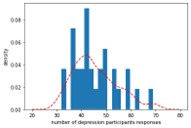
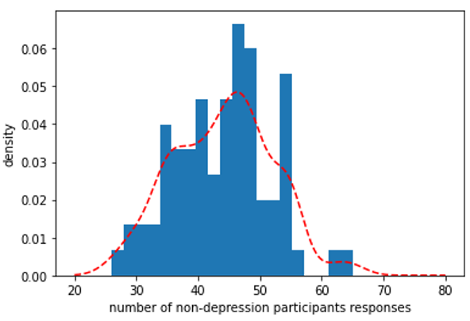

# DepressionDetection

#### Model
This is an in-class project that focused on depression detection. The model used in the project refers to https://github.com/speechandlanguageprocessing/icassp2022-depression. Based on the model, our project also imports resampling method to try improving the final results. 

#### Datasets
The datasets used in this project is a public English depression dataset called DAIC-WoZ dataset, provided by the University of Southern California. In the datasets, several sorts of data are provided for each participants including the video and text transcripts of the interview and detailed data on the participants' PHQ-8 scores, which was also used as a criterion to set the ground truth for classification. The database required application for usage, thus is not provided here. The database could be applied here: https://dcapswoz.ict.usc.edu/

#### Experiments
The Sampling in document was based on the statistical results below:

The resampling was based on:

The sample selection was based on:

A more detailed final report is available here: https://drive.google.com/file/d/1IoBBWEQHIehzyn-WoLK28Hm9U_a7xgLn/view?usp=share_link

**Reference:**

[1] Shen, Y., Yang, H., & Lin, L. (2022, May). Automatic depression detection: An emotional audio-textual corpus and a gru/bilstm-based model. In ICASSP 2022-2022 IEEE International Conference on Acoustics, Speech and Signal Processing (ICASSP) (pp. 6247-6251). IEEE.

[2] Gratch J, Artstein R, Lucas GM, Stratou G, Scherer S, Nazarian A, Wood R, Boberg J, DeVault D, Marsella S, Traum DR. The Distress Analysis Interview Corpus of human and computer interviews. InLREC 2014 May (pp. 3123-3128).

[3] DeVault, D., Artstein, R., Benn, G., Dey, T., Fast, E., Gainer, A., Georgila, K., Gratch, J., Hartholt, A., Lhommet, M., Lucas, G., Marsella, S., Morbini, F., Nazarian, A., Scherer, S., Stratou, G., Suri, A., Traum, D., Wood, R., Xu, Y., Rizzo, A., and Morency, L.-P. (2014). “SimSensei kiosk: A virtual human interviewer for healthcare decision support”. In Proceedings of the 13th International Conference on Autonomous Agents and Multiagent Systems (AAMAS’14), Paris.
